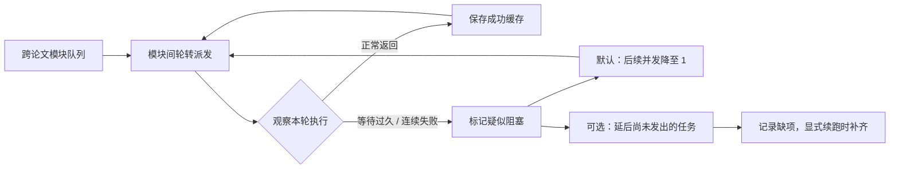

<div align="center">


**文献 OCR · 通用分析 · 可配置领域抽取**

Python SDK & CLI · v0.3.0 · Python 3.12+

从 PDF 到结构化结果；批量运行时隔离慢模块，保留成功阶段，按需补齐缺项。

SciEngine 的非官方调用 SDK，包含 MinerU OCR 与可配置领域抽取。

[快速开始](#quickstart) · [批量调度](#scheduling) · [Python 接入](#python-api) · [参数速查](#options) · [开发手册](docs/开发手册.md)

</div>

---

## 适用范围

scirelay 是一个可独立使用的文献处理调用包：通过 MinerU 处理 PDF，调用外部 SciEngine 服务完成五类通用分析，也可直接调用模型，按业务字段配置执行两阶段领域抽取。

已有 OCR 文档时可以直接抽取；只需要通用分析时，不必配置领域字段。SDK 提供类接口、命令行、批量示例和本地文件缓存，不启动 Web 服务。

| 环节 | Python 入口 | 命令行 | 产物 |
| --- | --- | --- | --- |
| PDF OCR | `MinerUClient` | `ocr` | Markdown、内容列表、版面与图片 |
| 文档适配 | `prepare_document` | `prepare` | `article.json`、`blocks.json`、`full.md` |
| 单篇通用分析 | `ScienceClient.run` | `extract` | `science_analysis`、逐模块缓存 |
| 跨论文通用分析 | `ScienceClient.run_batch` | `batch` | 逐篇结果、批次进度、调度状态 |
| 领域抽取 | `DomainExtractor.run` | `domain` | `core_fields`、来源块、待复核记录 |
| 状态查看 | 读取结果 JSON | `status` | 已落盘的状态，不调用接口 |

### 通用分析与领域抽取分别运行

| | 通用分析 | 领域抽取 |
| --- | --- | --- |
| 内容 | 研究问题、相关工作、研究设计、实验过程、未来展望 | 业务自定义的对象、工艺、测量等字段 |
| 执行方 | 外部 SciEngine 服务调用配置的模型 | 本地 SDK 直接调用配置的模型 |
| 输入 | `article.json` / `full.md` | `blocks.json` + 领域配置 |
| 结果 | `science_analysis` | `core_fields` |
| 调度 | 模块轮转、慢模块识别、降并发或自动延后 | 富集区定位 → 分类别字段抽取 |

仓库内的领域配置和文献示例均为虚构示意，**不内置耐磨钢正式字段配置、论文或历史抽取结果**。通用调度器的慢模块策略不适用于 `DomainExtractor`。

<a id="quickstart"></a>

## 快速开始

### 安装与配置

仓库已公开，无需邀请即可查看、克隆和通过 Git 安装。包名是 `scirelay`，Python 导入名和命令名为 `scirelay`；尚未发布到 PyPI。

```bash
git clone https://github.com/JYao-Chen/scirelay.git
cd scirelay
uv sync --locked
cp .env.example .env
```

编辑 `.env`，填写需要使用的服务：

```dotenv
MINERU_API_KEY=your-mineru-key
LLM_MODEL=your-model-id
LLM_BASE_URL=https://your-model-host.example/v1
LLM_API_KEY=your-model-key
```

| 变量 | 何时需要 | 说明 |
| --- | --- | --- |
| `MINERU_API_KEY` | OCR | MinerU 凭据 |
| `LLM_MODEL` | 通用 / 领域抽取 | 显式指定模型，无隐式默认值 |
| `LLM_BASE_URL` | 通用 / 领域抽取 | 模型根地址，不附加 `/chat/completions` |
| `LLM_API_KEY` | 通用 / 领域抽取 | 通用分析时经 SciEngine 转交，领域抽取时直接使用 |

SDK 不自动读取 `.env`；下文通过 `uv run --env-file .env` 加载，也可由应用注入环境变量或显式创建 `ModelConfig`。通用分析使用自定义模型地址时，SciEngine 服务器也必须能够访问该地址。`prepare` 和 `status` 不需要服务密钥。

在其他 Python 项目中安装：

```bash
uv add "scirelay @ git+https://github.com/JYao-Chen/scirelay.git"
```

Git 安装取得已推送的版本。使用尚未推送的本地改动时，可在目标项目通过 `uv add /absolute/path/to/scirelay` 安装本地包。

### 从一篇 PDF 开始

```bash
# 1. OCR：也支持递归扫描 PDF 目录
uv run --env-file .env scirelay ocr /path/to/paper.pdf \
  --output runs/demo/ocr

# 2. 适配：doc_0000 的原文件名映射见 OCR 的 run.json
uv run scirelay prepare runs/demo/ocr/papers/doc_0000 \
  --output runs/demo/document

# 3. 五类通用分析
uv run --env-file .env scirelay extract runs/demo/document \
  --output runs/demo/science

# 4. 查看已保存的结果与状态
uv run scirelay status runs/demo/science
```

OCR 单批支持 1–200 个 PDF，文件名须唯一；更大数据集自行分批。已上传或已下载的项目在续跑时跳过，不隐式重建收费批次。OCR 的 `--max-wait` 只限制轮询等待，不包括上传和下载。

### 已有文档，直接批量分析

将适配后的目录写入 `documents.json`。每个目录包含 `article.json` 和 `full.md`，清单中的相对路径以**清单文件所在目录**为基准。

```json
{
  "paper-a": "prepared/paper-a",
  "paper-b": "prepared/paper-b"
}
```

```bash
uv run --env-file .env scirelay batch documents.json \
  --output runs/batch --workers 10 --max-concurrency 10

uv run scirelay status runs/batch
```

默认收集全部五个模块。批次中单篇输入无效时会记录失败，其余有效论文继续执行。论文 ID 用作输出目录名，支持英文字母、数字、下划线、连字符、内部空格和点，禁止路径穿越及尾部空格或点。

<a id="scheduling"></a>

## 慢模块如何处理

调度器对五个模块采用相同规则，根据本轮运行的等待时长和连续失败次数识别疑似阻塞，无需提前指定哪个模块会慢。



每个模块分配公平并发份额，避免单个慢模块占满全部工作线程；空闲槽位用于继续推进其他模块、其他论文。实际并发可能低于设定总上限，SDK 不保证任意工作负载都能用满线程。

| 观察信号 | 默认阈值 | 默认处理 |
| --- | --- | --- |
| 某次尝试持续未返回 | `slow_after=120` 秒 | 该模块标记为 `blocked`，后续并发降至1 |
| 同模块连续失败 | `failure_threshold=2` 次 | 同上；当前实现计入各种调用失败，不只超时 |
| `blocked_action=defer` | 显式开启 | 该模块尚未发出的任务标记 `auto_deferred` |

这些信号不证明远端死锁，长文正常耗时也可能触发。健康状态在本轮内保持限制，显式续跑时重新观察。阈值、触发原因、逐模块状态保存在 `scheduler` 字段。

**正在执行的请求仍需等待返回或 HTTP 超时。** 自动延后只处理尚未发出的任务，不取消远端计算；有效并发只有1时，也必须等当前请求结束，其他任务才能推进。

### 先获取可用结果，再补缺

```bash
# 首轮：自动延后任意疑似阻塞模块的待发任务
uv run --env-file .env scirelay batch documents.json --output runs/batch \
  --slow-after 120 --failure-threshold 2 --blocked-action defer

# 后续：原目录补缺，默认降并发并继续执行，不再自动延后
uv run --env-file .env scirelay batch documents.json --output runs/batch
```

失败或自动延后的**必需模块**仍算缺项，结果为 `partial`。此命令能优先产出其他模块的结果，不会把不完整结果报成完整。

### 明确知道某些模块本轮不需要

`optional_modules` 定义完成条件，`deferred_modules` 控制是否发请求，两者独立。以下仅以未来展望为例，所有模块都支持相同策略：

```bash
uv run --env-file .env scirelay batch documents.json --output runs/planned \
  --optional-modules future_outlook --defer-modules future_outlook

# 取消可选和延后策略，补齐为全部模块完整
uv run --env-file .env scirelay batch documents.json --output runs/planned
```

第一轮其他必需模块成功后为 `complete_with_gaps`。已有成功缓存的延后模块仍会读入；只设 optional 不会阻止调用，只设 deferred 也不会把必需缺项变成成功。

<a id="options"></a>

## 参数速查

以下参数用于通用分析的 `extract` 与 `batch`。Python 对应参数由 `ScienceClient(...)` 和 `.run(...)` / `.run_batch(...)` 分别接收。

| CLI | Python | 默认值 | 作用 |
| --- | --- | --- | --- |
| `--workers` | `run*` 的 `workers` | 单篇3 / 批次10 | 执行线程上限 |
| `--max-concurrency` | `max_concurrency` | 10 | 同一客户端实例的 HTTP 并发上限 |
| `--module-limit MODULE=N` | `module_limits` | 无额外限制 | 指定模块上限，与公平份额取较小值 |
| `--timeout` | `timeout` | 600秒 | HTTP 读取等待 |
| `--module-timeout MODULE=S` | `module_timeouts` | 继承 `timeout` | 指定模块读取等待 |
| `--slow-after` | `slow_after` | 120秒 | 疑似阻塞的等待阈值 |
| `--failure-threshold` | `failure_threshold` | 2 | 连续失败阈值 |
| `--blocked-action` | `blocked_action` | `throttle` | 降并发，或用 `defer` 自动延后 |
| `--modules A B` | `run*` 的 `modules` | 全部五个 | 本运行固定的模块集合 |
| `--optional-modules A B` | `run*` 的 `optional_modules` | 无 | 哪些模块缺失仍允许必需工作完成 |
| `--defer-modules A B` | `run*` 的 `deferred_modules` | 无 | 哪些模块本轮只读缓存、不发新请求 |

`--module-limit` 和 `--module-timeout` 可重复传入，模块名不能重复。有效总并发为 `min(workers, max_concurrency)`；每模块公平份额为有效总并发除以选定模块数后向上取整，至少1。同一客户端的直接 `.extract()` 调用共享 HTTP 上限与显式模块上限，但不经过批次轮转和健康识别。不同客户端或进程不共享额度。

### 五个模块的名称与文件路由

| 内容 | 模块名 | 服务路径 | 上传文件 |
| --- | --- | --- | --- |
| 研究问题 | `research_question` | `/question` | `article.json` |
| 相关工作 | `related_work` | `/related-work` | `article.json` |
| 研究设计 | `research_idea` | `/innovation` | `article.json` |
| 实验过程 | `experiment_process` | `/experiment` | `full.md` |
| 未来展望 | `future_outlook` | `/future` | `full.md` |

客户端自动选择格式。仅运行一个模块时可用 `--modules future_outlook`；更改已运行目录的模块集合需要新输出目录。

<a id="python-api"></a>

## Python 接入

### 跨论文调度与续跑

```python
from scirelay import ModelConfig, ScienceClient

client = ScienceClient(
    ModelConfig.from_env(),
    max_concurrency=10,
    slow_after=120,
    failure_threshold=2,
    blocked_action="defer",
    module_timeouts={"research_idea": 900},
)
documents = {
    "paper-a": "prepared/paper-a",
    "paper-b": "prepared/paper-b",
}
result = client.run_batch(documents, "runs/python-batch", workers=10)
print(result["status"], result["all_modules_complete"])

# 后续显式续跑：成功阶段复用，仅提交缺失结果的模块。
backfill = ScienceClient(ModelConfig.from_env(), blocked_action="throttle")
result = backfill.run_batch(documents, "runs/python-batch", workers=10)
```

Python 映射中的相对路径以当前工作目录为基准；只有 CLI 清单采用相对于清单文件的解析规则。

<details>
<summary><strong>单篇、多模块与单接口调用</strong></summary>

```python
from scirelay import ModelConfig, ScienceClient

client = ScienceClient(ModelConfig.from_env())

# 多模块调用：保存缓存、状态和尝试记录。
result = client.run("prepared/paper-a", "runs/single")
analysis = result["science_analysis"]

# 单接口调用：返回模块原始 JSON，不创建运行目录或缓存。
future = client.extract("future_outlook", "prepared/paper-a/full.md")
```

</details>

### 自定义领域两阶段抽取

先编辑 [领域配置示例](schemas/domain-config.example.json)，定义 `domain_id`、`version`、`scope` 和 `categories`，再执行：

```bash
uv run --env-file .env scirelay domain prepared/paper-a/blocks.json \
  --config schemas/domain-config.example.json --output runs/domain/paper-a
```

阶段一读取全文、判断范围、登记研究对象并定位各类别富集区；阶段二按类别接收选中块，抽取原值、单位、工况及连续原文证据。来源不符合检查规则的记录单独保留为 `flagged_records`，不会混入已通过检查的记录。

空富集区不调用阶段二；`out_of_scope` 跳过阶段二。来源绑定检查不等于科学语义正确。超长输入不自动切片，模型输出截断记为失败。

```python
import json
from pathlib import Path
from scirelay import DomainExtractor, ModelConfig

config = json.loads(Path("schemas/domain-config.example.json").read_text())
result = DomainExtractor(ModelConfig.from_env()).run(
    "prepared/paper-a/blocks.json", config, "runs/domain/paper-a", workers=3,
)
```

### 端到端批量示例

```bash
uv run --env-file .env python examples/pipeline.py /path/to/pdfs \
  --output runs/pipeline --blocked-action defer \
  --domain schemas/domain-config.example.json
```

示例先完成 OCR/适配，再执行跨论文通用队列，最后运行领域抽取；去掉 `--domain` 即只运行通用链。它不会让领域抽取与尚未返回的通用请求并行。其他示例见 [examples](examples/README.md)。

## 输出、状态与续跑

```text
runs/batch/
├── run.json                         # 批次身份与最终状态
├── summary.json                     # 逐篇状态、缺项、错误与调度观察
└── papers/
    └── paper-a/
        ├── run.json                 # 输入及非秘密模型配置
        ├── extraction_result.json   # science_analysis、attempts、scheduler
        └── stages/
            └── <module>.json        # 成功模块响应
```

单篇 `extract` 直接在指定目录保存 `run.json`、`extraction_result.json` 和 `stages/`。领域抽取使用独立目录，保存 `core_fields`、阶段输入和模型响应。

| 最终状态 | 含义 | 调用方判断 |
| --- | --- | --- |
| `complete` | 所有选定模块都有成功结果 | `all_modules_complete=true` |
| `complete_with_gaps` | 必需模块完成，可选模块仍缺失或失败 | `required_complete=true`，全部完整为 false |
| `partial` | 必需模块缺失，或批次内有输入/配置失败论文 | 查 `missing_modules`、`errors` 和逐模块状态 |

执行中会出现 `running` / `processing`；领域范围外结果为 `skipped`，领域阶段整体失败可为 `failed`。`complete` 描述运行完整性，不证明事实正确。

CLI 完成或 `complete_with_gaps` / 合理 `skipped` 返回0；`partial`、`failed`、调用异常返回1；缺少环境配置返回2。`status` 读取到运行中状态也返回1；它只读文件，不探测进程是否仍存活。进程异常退出时，文件可能保留上次状态。

### 哪些变化允许原目录续跑

| 变化 | 处理 |
| --- | --- |
| 调整线程、并发、超时、阻塞策略 | 原目录续跑 |
| 调整可选 / 手动延后模块 | 原目录续跑 |
| 补跑失败、自动延后或尚未完成模块 | 原目录续跑，成功缓存复用 |
| 更换模型、服务、输入路径/大小/修改时间、模块集合或领域配置 | 使用新运行目录 |
| 改变批次清单或论文 ID | 使用新批次目录 |
| 成功缓存损坏 | 记录失败；检查并移走损坏阶段文件后显式续跑 |

每个输出目录只允许一个写入进程，不具备跨进程锁。一次运行不自动重试失败请求；显式续跑才重新提交无成功缓存的任务。HTTP 读取超时不改变服务器内部 deadline，也不能证明远端计算已停止。

API Key 不写入运行配置，已知凭据会从错误中脱敏。OCR 状态文件可能包含临时签名 URL，运行目录不应公开提交。仓库不包含密钥或论文运行数据。

## 开发与验证

```bash
uv sync --locked --group dev --group docs
uv run pytest -q
uv run ruff check src tests examples scripts
uv run ruff format --check src tests examples scripts
uv run python scripts/build_docs.py
uv build
```

当前版本本地验证：**56项测试通过**，包含模拟调用及本地 HTTP 服务；覆盖五模块逐一变慢后的隔离、自动延后与补跑、连续失败、全局并发、缓存与输入变化、OCR 续跑、领域两阶段及来源检查。Ruff、文档生成、sdist/wheel 构建和独立安装检查通过，记录见 [验证记录](docs/验证记录.md)。

本轮未重新调用真实 OCR 或模型服务，尚无真实服务吞吐增益或科学抽取准确率验证。

## 文档导航

| 任务 | 文档 |
| --- | --- |
| 理解调度、阈值、自动延后与恢复边界 | [批量调度与慢模块](docs/10-批量调度与慢模块.md) |
| 查 Python 类、方法及返回值 | [SDK 使用](docs/09-SDK使用.md) |
| 查配置、超时与故障处理 | [开发运行与排障](docs/05-开发运行与排障.md) |
| 配置领域抽取与来源契约 | [两阶段抽取](docs/04-两阶段抽取.md) · [schemas](schemas) |
| 查外部接口与上传格式 | [外部接口](docs/02-外部接口.md) · [OpenAPI](docs/api/external-services.openapi.json) |
| 阅读完整手册 | [Markdown](docs/开发手册.md) · [离线 HTML](docs/开发手册.html) |
| 查看结构与流程 | [可编辑 Mermaid / SVG 图](docs/diagrams/README.md) |
| 集成到 App | [App 集成](docs/06-App集成.md) · [平台化设计](docs/07-平台化设计.md) |

外部服务：[SciEngine 文献抽取](https://sciengine.las.ac.cn/literatureExtraction/) · [MinerU](https://mineru.net/apiManage/docs)。本包提供调用侧代码，不包含这些服务的内部实现。文档中的自有任务 HTTP API 属于设计，尚未部署。
